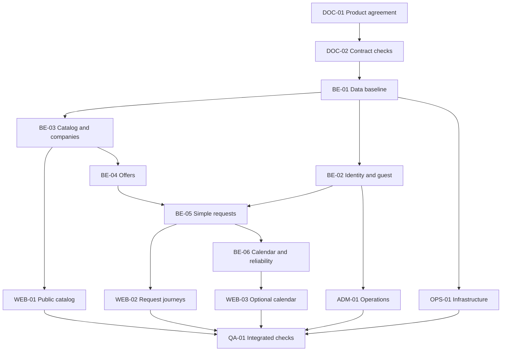

# Пакет реализации — параллельная разработка Services

**Статус:** PLAN / 2026-11-02. Источник требований: `docs/ru/01-product.md`, ADR-0001–0005; ADR-0006 только PROPOSED. Все задачи проходят через отдельные PR. Референсные схемы не означают работающий backend.

## Правила параллельности
- `services` — единственный источник бизнес-правил и OpenAPI. Изменение публичного API сначала согласовать здесь; затем генерировать типы и обновлять потребителей.
- Сессии/разработчики получают собственные ветки и чёткое владение файлами; не переписывают чужие модули, не делают auto-merge.
- Нельзя одновременно менять одни и те же Prisma-модели или общий API контракт без последовательного review.
- Изолировать контроллеры, domain services, persistence, UI, test fixtures; бизнес-инварианты enforce backend+DB, а не только frontend.
- На каждую задачу: IDs требований, актор, предусловия, состояния, permissions/ACL, API, данные, ошибки, тесты, i18n, обратная совместимость и rollback.

## Последовательность G0 → G4

| ID | Репо / компонент | Задача | Зависимости | Проверка готовности |
| --- | --- | --- | --- | --- |
| DOC-01 | services | ADR-0006 decision review; удалить несовместимые упоминания schedule PATCH | product owner | ADR accepted/revised, versioned changes |
| DOC-02 | services | OpenAPI lint + Prisma validation + contract checks | DOC-01 для final flows | Passing CI logs and exact commit |
| BE-01 | services-back | Config, DB migrations, health, modular shell, transactions | DOC-02 | Migration rollback, PostgreSQL integration |
| BE-02 | services-back | Auth Person, sessions, scoped guest OTP and capabilities | BE-01, auth ADR | Negative ACL, brute-force, replay, expiry |
| BE-03 | services-back | Geo/taxonomy/profile/company and two-sided views | BE-01 | ACL/IDOR, visibility intersection, public cache |
| BE-04 | services-back | ServiceOffer with contact channels, optional calendar | BE-03 | Seller XOR; mandatory one working intake |
| BE-05 | services-back | ServiceRequest lifecycle, idempotency, outbox | BE-02, BE-04 | accept/decline/cancel races, exactly two cancellation intents |
| BE-06 | services-back | Schedule proposal, busy allocation, snapshot/reliability | BE-05, DOC-01 | two-party confirmation, no incorrect penalty, DST, overlap |
| WEB-01 | services-front | SSR search, locale/city selection, public professional/company pages | BE-03 | anonymous E2E, cache/SEO, kk/ru |
| WEB-02 | services-front | Request UX, guest verification, private status | BE-02, BE-05 | offline/timeout/retry, 409, mobile |
| WEB-03 | services-front | Optional calendar + consented schedule confirmation | BE-06 | distinction desired vs confirmed time, grace deadline |
| ADM-01 | services-admin | Admin auth MFA, taxonomy and claims/moderation | BE-02, BE-03 | scoped RBAC, audit, data minimization |
| OPS-01 | all | Protected CI, staging, monitoring, migration rollback | BE-01 | Repeatable evidence per repo |
| QA-01 | all | E2E cross-repo security/performance/accessibility | Above vertical slices | Verified flows and privacy tests |

## Dependency graph

## Vertical slices and ownership

**Slice A — discovery:** public city search → published profile/offer → direct phone/WhatsApp (no platform request). No required account, GPS, pricing, payment or calendar. Test no private/corporate field leak.

**Slice B — request:** guest verifies original contact → creates `PENDING` → seller accepts/declines → both parties read their own state. Separate company/person seller routing. Assert no phantom request on network retry.

**Slice C — cancellation:** accepted request → cancel by either side → DB transaction records state, busy release (if applicable), reliability decision and exactly two intent rows; asynchronous delivery retries. Never modify review stars.

**Slice D — scheduling:** explicitly proposed time → other party confirms → only then snapshot and, if relevant, busy lock; reschedule suspends customer penalty until mutually confirmed. Implement only after ADR-0006 review.

## Backward compatibility / release
- Migration is forward-only at deployment with pre-tested rollback/recovery; maintain old public DTOs until client migration.
- Treat typed enum changes as contract changes, not cosmetic refactors.
- No secrets/guest contact values in logs, static files, analytics or sample responses.
- All private routes `Cache-Control: no-store`; public SSR pages cache only explicitly published fields and invalidate on revocation.
- Re-run `kk`/`ru`, mobile viewport, screen reader labels, 409/429/5xx/offline, retry and clock-boundary tests.

## Definition of Done per task
A task is DONE only when merged source, migration/contract version, tests and CI link, reproducible runtime verification, updated docs, risk/rollback note and independent review are present. A drafted file or prototype is only DESIGNED.
