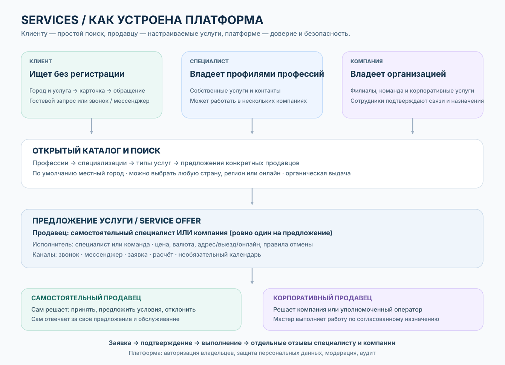

# 01. Services — продукт, цель и полная картина
> **Product blueprint v0.6 · 2026-11-01.** Основа утверждена владельцем продукта. Детали, не отмеченные как утверждённые, — предложения и открытые решения. Документация описывает целевое поведение, а не реализованное приложение.

## Что такое Services
**Services — глобальный открытый каталог услуг с приоритетом местного города/региона**, где потребитель без регистрации находит нужную услугу или специалиста, а человек или организация публикует страницу и получает обращения. Платформа соединяет стороны, помогает сохранять контакты и может служить добровольным календарём занятости. **Это не платёжный посредник, не площадка для торгов, не обязательная CRM и не система контроля стоимости.**

Ценности:
- Клиент: быстро найти подходящую услугу и способ связаться, без обязательной регистрации и геолокации GPS.
- Специалист: постоянная профессиональная страница, портфолио и репутация независимо от работодателей.
- Компания: собственная витрина, филиалы, услуги, команда и управление обращениями от имени компании.
- Авторизованный клиент: избранное, подписки, собственная история и возможность более достоверных отзывов.
- Платформа: честный поиск и отдельные отзывы, ограниченная модерация, защита данных и прозрачная реклама.

## Общая схема Services

[Редактируемая Mermaid-схема для ИИ](https://github.com/nurgeldiserikbay/services/blob/main/docs/diagrams/platform-overview.mmd) · [Техническая архитектура](https://github.com/nurgeldiserikbay/services/blob/main/docs/ru/20-backend-implementation.md) · [Схема простых заявок](https://github.com/nurgeldiserikbay/services/blob/main/docs/ru/04-booking-reviews.md).

## Аудитория и возможности
| Пользователь | Без входа / базовые действия | После входа / владеет |
| --- | --- | --- |
| Гость | Поиск по городу/стране/онлайн, фильтры, карточки, портфолио, отзывы, разрешённые контакты, звонок и WhatsApp; простая гостевая заявка с проверкой контакта | Не имеет кабинета и чужих приватных данных |
| Авторизованный клиент | Всё, что гость | Закладки специалистов/компаний/услуг, подписки, собственная история заявок, удобное повторное обращение, отзывы по правилам проверки |
| Специалист | Публичная страница одной канонической профессии, несколько профессий у одного человека | Редактор личной страницы, предложения услуг, доступные каналы, заявки, календарь по желанию, связи с компаниями, разрешения на показ своего профиля, статистика |
| Компания | Публичная страница организации и филиалов | Компания, филиалы, предложения, команда, согласованные назначения специалистов, корпоративные версии их карточек, заявки, роли, статистика |
| Оператор/делегат | Нет полномочий без явного назначения | Только конкретные операции в конкретном контексте и филиалах |
| Администрация платформы | Доступ по отдельным ролям | Справочники профессий/услуг, модерация и жалобы, проверки, аудит, региональные ограничения, защита от мошенничества |

Один человек может одновременно выступать клиентом, специалистом нескольких профессий и владельцем компании; аккаунт общий, рабочие пространства раздельные.

## Основной сценарий потребителя
1. Открывает сайт без регистрации. Выбранный ранее регион имеет приоритет; иначе сайт может предложить приблизительный город по сети, не требуя GPS. Переключение на другую страну, город или онлайн доступно всегда.
2. Ищет по словам, категориям, профессиям, специализациям или конкретным услугам. Видит **отдельно** предложения специалистов и компаний, город/зону обслуживания и реальные отзывы.
3. Открывает профиль или карточку услуги. Цена может быть фиксированной, ориентировочной, «от» или вовсе не указана; платформа не согласует сумму.
4. Выбирает опубликованный продавцом канал: звонок, WhatsApp/мессенджер, простая заявка или свободное окно **если продавец включил календарь**.
5. При заявке в Services вводит минимум данных (для гостя — подтверждение контакта), продавец **сам принимает или отклоняет**. Можно отменить; если стороны договорились вне платформы, продавец при желании вносит занятость вручную.
6. После услуги клиент может сохранить страницу; авторизованный клиент при достаточном подтверждении оказания услуги оставляет отзыв. Нельзя считать клик WhatsApp заказом или визитом.

## Самостоятельный специалист и компания
**У каждого ServiceOffer ровно один продавец/получатель заявки**: независимый ProfessionalProfile **или** Organization. Исполнитель и продавец — разные роли, когда специалист оказывает корпоративную услугу.

| Откуда клиент нажимает «Обратиться» | Получатель заявки | Что видит клиент |
| --- | --- | --- |
| Личная страница мастера, личное предложение | Мастер | Личное предложение и каналы мастера |
| Страница компании, её предложение | Компания/оператор | Название компании, филиал, услуга |
| Карточка мастера внутри страницы компании | Компания, мастер указан исполнителем | Корпоративное оформление и корпоративные каналы |
| Личная страница мастера → явная кнопка «Услуга в компании X» | Компания X после перехода в её контекст | Смена продавца показана явно |

Нельзя скрытно менять получателя заявки. Компания не становится владельцем личной страницы или клиентов мастера. Заявка по корпоративному предложению не переносится в личный кабинет мастера из-за его ухода из компании.

## Одна профессиональная личность — несколько отображений
Для каждой канонической профессии у человека один ProfessionalProfile, в том числе скрытый/архивный. Специалист может иметь несколько **разных** профессий; специализации и названия услуг не требуют новых профессиональных страниц.

- **Личная страница:** мастер управляет биографией, портфолио, личными контактами, самостоятельными услугами и настройками публикации.
- **Карточка внутри компании:** эта же профессиональная личность рендерится в дизайне компании. Мастер разрешает конкретные фото/поля **для каждой компании отдельно**; компания выбирает подмножество разрешённого и свои корпоративные сведения/услуги.
- Итоговое поле отображается только если **мастер разрешил И компания выбрала И платформа допускает**. Компания не может редактировать чужую профессиональную биографию, подменять рейтинг, подтверждения и оригинальные отзывы.
- При окончании Affiliation корпоративное представление скрывается, а личный профиль, подписчики и профессиональные отзывы остаются у мастера.

## Гибкое расписание без принуждения
Специалист может выделять время для разных контекстов: например, салон A пн–пт 09:00–18:00, самостоятельная работа 19:00–22:00, компания B по субботам. Корпоративные периоды согласуются обеими сторонами. Личное время принадлежит только специалисту.

Отдельно настраиваются способы связи и видимость занятости: **скрыто**, **только занято/свободно** или **публичные свободные слоты**. Публичного календаря может вообще не быть. Если в Services известны принятые пересекающиеся записи одного мастера, система не должна одновременно подтверждать конфликтующие окна. Другой компании можно сообщать лишь «недоступен», не раскрывая личный заказ. Записи по телефону не известны платформе, пока продавец не добавит их вручную.

## Как понимать категории, профессии и услуги
Это **навигация для поиска**, а не жёсткая иерархия и не несколько аккаунтов: «Красота» (категория) → «Парикмахер» (профессия) → «Колористика» (специализация) → «Окрашивание волос» (тип услуги) → конкретные предложения мастера и салона. У одной услуги может быть несколько подходящих профессий. Канонические коды, многоязычные синонимы и stable IDs поддерживаются платформой.

## Отзывы, закладки и статистика
Отзывы о мастере, компании и филиале — **разные цели**. Авторизация повышает доверие к автору, но сама по себе не доказывает факт оказанной услуги. Метка `verified` допустима только после достаточного подтверждения факта (метод до запуска утвердить отдельно). Нельзя купить или удалить правдивый негативный отзыв ради рекламы.

Аккаунт клиента даёт личное избранное, подписки и собственную историю. Продавцу показываются агрегированные **просмотры страниц**, **клики контактов**, **полученные заявки**, **принятые** и, отдельно, **подтверждённые** услуги. Количество уникальных **авторизованных** обратившихся клиентов можно считать при законных основаниях и дедупликации; оно не равно числу всех клиентов, особенно при гостевых/внешних обращениях. Личные списки избранного других людей продавцу не открываются.

## Глобальная работа и локальный поиск
Каталог работает глобально, но начальный поиск — выбранный город/регион. Приоритет: явный выбор устройства → сохранённый выбор аккаунта (если не конфликтует) → добровольная геолокация «Рядом со мной» → осторожная приблизительная сеть/IP → ручной выбор. Язык интерфейса не определяет физическую страну. Варианты: город, регион, страна, весь мир, онлайн. Если предложений мало, выдача **явно предлагает** расширение. Местные, выездные и онлайн-услуги различаются. Предложение действует в указанной зоне; нельзя изображать далёкого продавца как местного.

## Монетизация и ограничения
Бесплатная базовая органическая публикация страниц и предложений, платное продвижение позже с явной пометкой «Реклама». Платёжный посредник/эквайринг, тарифы и автоматическое ценообразование **не входят в MVP**. Глобальный охват не означает разрешения работать в любой стране или лицензируемой сфере: требования к персональным данным, рекламе, регулируемым категориям и защите потребителей проверяются **по странам до включения соответствующих операций**.

## Техническая концепция и скорость
| Часть | Роль |
| --- | --- |
| `services` | Markdown как source of truth, HTML-сайт документации, ADR, схемы и OpenAPI |
| `services-front` | Next.js для SEO/SSR/PWA, mobile React/Vite/Capacitor и общие UI/фичи/локализации |
| `services-back` | NestJS modular monolith, PostgreSQL/Prisma, ACL, геопоиск, заявки, календари, уведомления |
| `services-admin` | Отдельный Next.js для модерации, верификации, справочников и аудита |
| CDN и worker | Кеш только публичного, безопасные медиа, уведомления и пересчёт агрегатов без задержки запроса |

Одна бизнес-платформа **не означает один тяжёлый экран или единый JS-bundle**. Публичный поиск не загружает редактор страниц/календарь и не обращается к приватным кабинетам. Индексы, пагинация, lazy-loading, публичный кеш с инвалидацией и наблюдаемость нужны с начала; микросервисы — только по измеренным узким местам.

## Где подробности и что ещё не утверждено
- [Организации, назначения, корпоративные представления](https://github.com/nurgeldiserikbay/services/blob/main/docs/ru/03-organizations-services.md)
- [Простая заявка, календарь, отзывы](https://github.com/nurgeldiserikbay/services/blob/main/docs/ru/04-booking-reviews.md)
- [Безопасный конструктор](https://github.com/nurgeldiserikbay/services/blob/main/docs/ru/05-page-builder.md)
- [Полные требования с ID](https://github.com/nurgeldiserikbay/services/blob/main/docs/ru/13-functional-catalog.md)
- [Права доступа](https://github.com/nurgeldiserikbay/services/blob/main/docs/ru/15-permissions-matrix.md)
- [Границы состояний](https://github.com/nurgeldiserikbay/services/blob/main/docs/ru/16-state-machines.md)
- [Архитектура и план разработки](https://github.com/nurgeldiserikbay/services/blob/main/docs/ru/22-delivery-roadmap.md)
- [Открытые вопросы и решения до реализации](https://github.com/nurgeldiserikbay/services/blob/main/docs/ru/12-roadmap-decisions.md)

**До начала предметной реализации нужно утвердить:** факт выполнения для verified reviews; ограничения/уведомления при изменении и отмене времени; принадлежность и срок хранения гостевых контактов; пересечения корпоративных/личных смен; набор полей «мастер разрешает / компания выбирает»; авторизацию web/mobile; data residency/правовые условия по странам; финальный API, Prisma schema и тесты. Эти детали не должны возвращать Quote, обязательную цену и сложную коммерческую воронку.
