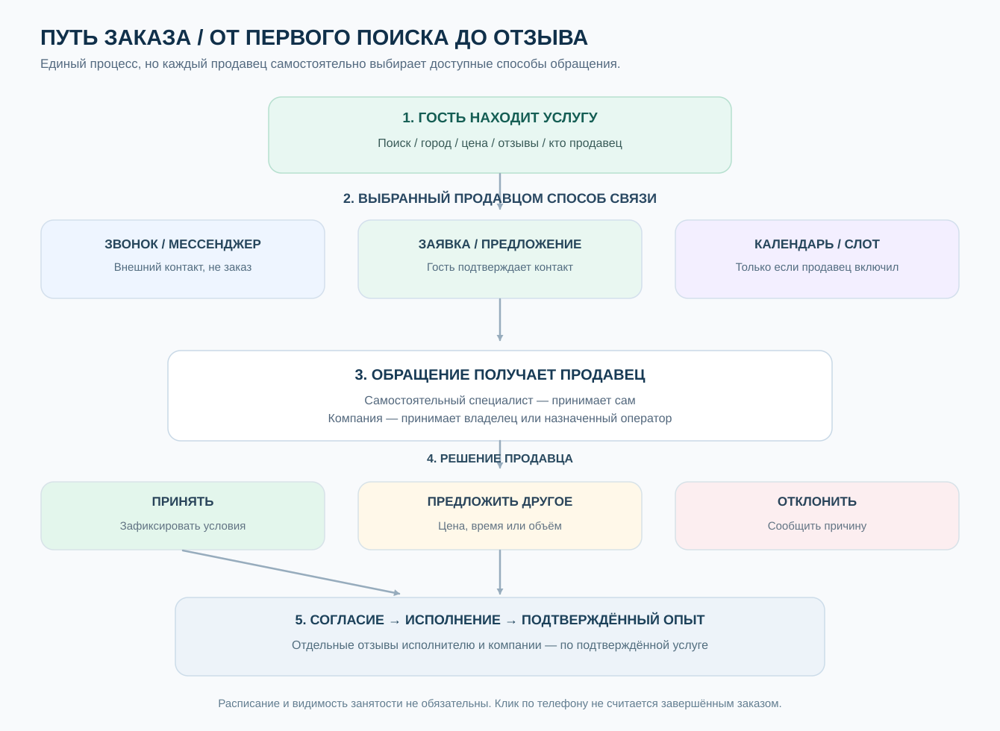

# 04. Заявки, визиты, отзывы, рекомендации
> Статус: предлагаемое бизнес-правило v0.1 · Приоритет: MVP

## Схема: от поиска до принятого заказа

**Принцип:** продавец настраивает доступные способы контакта отдельно для каждого предложения и решает, принимать ли входящий запрос. Специалист как самостоятельный продавец обрабатывает своё предложение сам. Когда продавец — компания, решение принимает её уполномоченный сотрудник. Опубликованное расписание, показ занятости и приём слотов — необязательные возможности. Звонок или переход в мессенджер сами по себе не являются подтверждённым заказом.

Редактируемый источник для ИИ и разработчиков: [Mermaid-схема процесса заявки](https://github.com/nurgeldiserikbay/services/blob/main/docs/diagrams/order-lifecycle.mmd).

## Типы взаимодействий
Appointment (слот) для салонов, Consultation (запрос) для диагностики, Quote (смета) для проектных услуг и Order для заданных пакетов. MVP реализует универсальный запрос/запись с подтверждением вручную; расширенная доступность и платежи отложены. Тип offer определяет допустимые поля и процесс.

## Настройки приёма заявок — решение владельца предложения

| Режим | Как видит клиент | Как действует продавец |
| --- | --- | --- |
| Только телефон/мессенджер | Публичная контактная кнопка без регистрации | Самостоятельное общение; переход не считается заказом |
| Принимать заявки | Краткое описание задачи и контакт; гость подтверждает канал | Владелец или уполномоченный оператор принимает, отказывает или предлагает условия |
| Запросить расчёт | Описание, фотографии (после защиты), желаемые сроки | Продавец предлагает цену/условия; клиент подтверждает |
| Запись по запросу | Клиент предлагает дату/время без просмотра занятости | Продавец вручную подтверждает или переносит |
| Показать занятость | Статус либо календарь — если продавец захотел | Сам регулирует видимость и доступность |
| Опубликованные слоты | Свободные окна — только если календарь включён | В MVP возможно ручное одобрение; auto-confirm лишь после явного opt-in и контроля capacity |

**Не принуждать к расписанию**: видимость занятости `hidden | status_only | public_schedule | bookable_slots`; приём `manual_only | request_slot | instant_if_available`. Для каждого offer выбираются доступные каналы и условия. График работы организации не равен времени, свободному для бронирования. Смена политики не переписывает уже принятые заявки.

**Ответственность:** один продавец на ServiceOffer — самостоятельный специалист или компания. Если корпоративный offer, компания назначает уполномоченного оператора и исполнителя; исполнитель не может поменять корпоративную цену без разрешения. Приём клиентской заявки — действие продавца, а не автоматическое одобрение платформы.

**Репутация:** публичные оценки с меткой verified по умолчанию допускаются только от авторизованного автора с подтверждённым ServiceExperience. Подтверждение телефона гостя доказывает лишь владение каналом, не личность и не факт визита. Для гостя возможна передача непубличной обратной связи/жалобы с отдельной верификацией; нельзя создавать фиктивные рейтинговые отзывы. Проверка reviewer eligibility, антифрод и appeal выполняются сервером, с учётом требований применимой юрисдикции.

## Состояния Booking
draft → requested → accepted → in_progress → completed;
requested → rejected или withdrawn; accepted → cancelled_by_client / cancelled_by_provider; accepted → reschedule_requested → accepted или cancelled. Состояния должны быть валидированы сервером. Отдельно фиксируются no_show и disputed по правилам, без автоматического публичного наказания клиента.

Повторные отправки/двойные нажатия используют idempotency key; назначенные временные слоты проверяются транзакционно. В accepted сохраняются snapshot цены, продавца, места, услуги, исполнителя, валюты и условий отмены. При изменениях клиент получает уведомление и должен повторно согласовать материальные изменения.

## ServiceExperience
После фактического оказания услуги создаётся или подтверждается запись факта исполнения, связанная с booking, услугой, профилем исполнителя, организацией/филиалом при наличии, датой. В MVP: взаимное подтверждение завершения либо QR/код посещения, при споре — ручная модерация. Сам по себе статус accepted не разрешает «подтверждённый отзыв».

## Отзывы: чья репутация
Из одного ServiceExperience можно оставить **отдельный отзыв профессионалу** и **отдельный отзыв компании/филиалу**. Они принадлежат своим неизменяемым целям. Профессиональный отзыв остаётся при переходе мастера. Организационный отзыв остаётся организации. Рейтинг врача не смешивается с рейтингом парикмахера того же человека.

- Одно право на отзыв данного автора для данного опыта и типа цели; изменения по правилам редактирования, исходная версия аудируется.
- Запрещены покупка звезд, удаление негативных отзывов работодателем и перенос между целями.
- Модерация может скрыть отзыв по утверждённой причине, а не вручную изменить оценку.
- Публично не показываются идентификаторы заказов, телефоны, адреса клиента, диагнозы, чувствительные материалы.
- Агрегация учитывает количество, актуальность и доверие к сигналу; не усредняет профессии в «рейтинг человека».

## Рекомендации и подписки
Review (опыт услуги), Recommendation (явная рекомендация), Follow (интерес к обновлениям) — отдельные модели. Подписка возможна на общую публичную страницу, конкретную профессию, компанию или филиал. Смену места работы публикуем только подписчикам соответствующего профиля, с учётом настроек человека и уведомлений.

## Конфликты
При жалобе на отзыв: reason→evidence→moderation→decision→appeal. Статусы «проверяется», «скрыт», «отклонён»; все решения аудируются. Счётчик отзывов и рейтинг должны корректно перерасчитываться после решений.

## Приёмка
- Один опыт → два разных объекта оценки без дублирования профессионального рейтинга.
- Изменение компании не меняет review.target_id.
- Нет подтверждённого опыта → нельзя присвоить метку «подтверждённый визит».
- Двойной запрос не создаёт два бронирования.
- Отмена не исчезает из истории, а проходит разрешённый переход.
