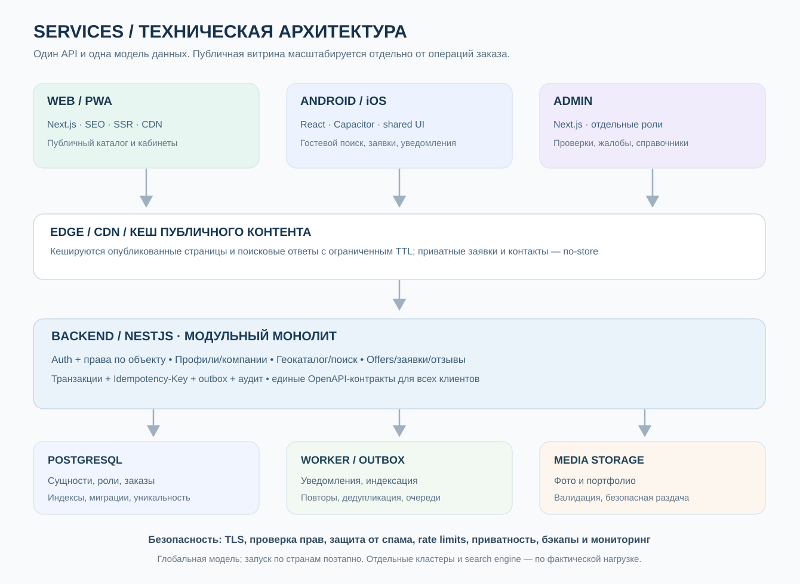

# 20. Backend: модули, операции, асинхронность и интеграции
> Архитектура реализации v0.2 · services-back · NestJS / Prisma / PostgreSQL.

## Общая схема технической архитектуры

Это схема **одной логической платформы**, а не требование запускать десятки серверов. Начать с одного модульного монолита NestJS, независимых Web/Admin приложений, PostgreSQL, объектного хранилища и фонового обработчика; масштабировать компоненты по метрикам. Для ИИ доступна [редактируемая Mermaid-схема](https://github.com/nurgeldiserikbay/services/blob/main/docs/diagrams/technical-architecture.mmd).

## Масштабирование без ненужных микросервисов
- Весь бизнес-процесс **не должен находиться в одном frontend bundle**: публичная витрина SSR/SEO и кешируемые страницы отделены от авторизованных кабинетов, тяжёлый конструктор грузится лениво; mobile делит фичи и компоненты, но не SSR runtime.
- **CDN** для статических ресурсов/изображений и опубликованных страниц; короткий публичный API cache по явному городу/сервису/языку с корректным invalidation. Приватные данные заявок, контактов клиентов, OTP и админские API — `Cache-Control: private, no-store`.
- **PostgreSQL** остаётся единственным источником истины: индексы по доступности offer, стране/городу/категории, курсорная пагинация, лимиты выдачи, materialized/aggregated read models по измеренной необходимости. Не делать дорогие JOIN и пересчёт репутации на каждом запросе.
- **Outbox + worker** для уведомлений, индексации, пересчёта агрегатов, загрузки медиа и антифрода. Очередь Redis/отдельный поисковик подключать только после профилирования. Ошибка пуша не отменяет подтверждённый заказ.
- **Безопасные транзакции** принятия заявки: idempotency key + optimistic version + row constraints на слоты только для активированного календаря. Нет необходимости хранить миллионы заранее сгенерированных свободных слотов.
- Горизонтальное масштабирование API при фактической нагрузке, соединения Postgres через pool, ограничения клиентских запросов и circuit breakers к сторонним услугам; CDN не может заменять проверку прав.

## Модель самостоятельного продавца и компании
`ServiceOffer.seller` — типизированный владелец предложения: independent_professional_profile_id **или** organization_id; check exactly-one и сильные FK/constraints. `Performer` и `ServiceAssignment` — отдельные объекты. У независимого продавца обработчик — владелец профильной услуги; у компании — явно уполномоченный оператор в рамках scope. Клиентская заявка хранит snapshot продавца, предложения, цены/условий. Нельзя перенести заказ компании в личный кабинет мастера только потому, что он выполнял услугу.

`OfferIntakeSettings`: `methods`, `manual_accept_required`, `availability_visibility`, `booking_mode`, `timezone`, `capacity?` и ограничения конкретного типа услуги. **Показ занятости и календарь добровольны**; отсутствие слотов не означает недоступность заявки или невозможность публикации предложения. `ServiceRequest` — запрос/контакт, `Booking` — подтверждённое соглашение; нужен ADR об их выделении или единой типизированной модели.

## Слои
Controller (HTTP, auth, DTO) → Application use case (orchestration/transaction) → Domain policy (invariants/state machine) → Repository interface → Prisma adapter. Разделять REST payload и внутренние domain objects. Общий модуль Config, Logger, Exception filter, Request Context, AuthGuard, Authorization Policy Engine, Transaction Manager. Нельзя писать бизнес-переходы внутри controller или Prisma middleware.

## Границы модулей
Identity/Auth, People, ProfessionalProfiles, Taxonomy, Organizations, Affiliation, Offers, Assignments, Booking, Experience, Reputation, Social, Media, PageBuilder, Notifications, Verification, Moderation, Billing (P2), Audit/Outbox. Публичные интерфейсы модулей, не прямые импорты внутренних таблиц через весь код.

## Первые use cases в порядке разработки
1. RegisterUser, VerifyContact, CreatePerson, ListWorkspaces.
2. CreateProfessionalProfile (unique DB), SaveProfileDraft (version), PublishProfile, Pause, Hide, Archive, Restore, RequestDeletion.
3. CreateOrganization, CreateLocation, InviteOrganizationMember, AssignScopedRole.
4. InviteAffiliation, AcceptAffiliation, EndAffiliation.
5. CreateServiceOffer, PublishOffer, ProposeAssignment, AcceptAssignment, RevokeAssignment.
6. SearchProfiles/Offers, GetPublicProfessional, GetPublicOrganization.
7. RequestBooking, AcceptBooking, CancelBooking, CompleteBooking, RecordServiceExperience.
8. CreateReview (professional + organization separately), FollowProfile, NotifyFollowers.
9. ReportContent, ModerateCase, AppealDecision.

## Данные и транзакции
PostgreSQL является source of truth. Использовать DB constraints для уникальности и FK, explicit $transaction для состояния+события+аудита. Повторные команды безопасны: actor_id+operation+idempotency_key и response hash; проверять request_hash, чтобы один ключ нельзя было повторно использовать с другим payload. Optimistic concurrency на draft/booking.

## Outbox
В транзакции пишутся доменное изменение, AuditEvent, OutboxEvent. Worker публикует уведомления после commit. Job consumer проверяет event_id; exponential retries, dead-letter/manual replay. Redis/queue не обязателен на старте, если outbox в Postgres достаточно. На уровне HTTP не ждать доставки email/push.

## Работа с медиа
Предварительный authenticated upload intent → signed upload URL (если доступен) → scan/validation → media asset ready → публикация. Публичные и приватные объекты разделены; thumbnails оптимизированы; лимиты и контроль EXIF/PII. При удалении профиля медиа удаляются или открепляются по retention policy.

## Search
На старте PostgreSQL (tsvector, trigram) с индексацией названий kk/ru и нормализацией транслитерации. Три сущности поиска: professional, organization, offer; deduplicate по профилю, разделить типы. Релевантность: текстовое совпадение, сфера, география, доступность, рейтинг доверия — без неявного платного повышения органического ранга. Elasticsearch/OpenSearch только после фактической потребности.

## Интеграции
Adapters для SMS/Email, push (FCM/APNs через mobile), карты/geocoding, analytics, платежи (P2). Timeout, retry policies, rate-limits, безопасное логирование, стоимости API под контролем.

## Env / topology
API как stateless контейнер, PostgreSQL с миграциями, storage bucket, worker. Dev/staging/prod изолированы. Schema migration review, health checks, graceful shutdown, request deadlines, structured JSON logs. Secrets не должны попадать в frontend.

## Acceptance by layer
Unit: profiles one-per-profession; domain transitions; review target. DB integration: uniqueness/races; foreign keys; cross-org isolation. Contract: OpenAPI response/error. Security: auth, IDOR, revoked role, spam, upload. E2E: full user journey. Performance: latency/search under pilot load.
