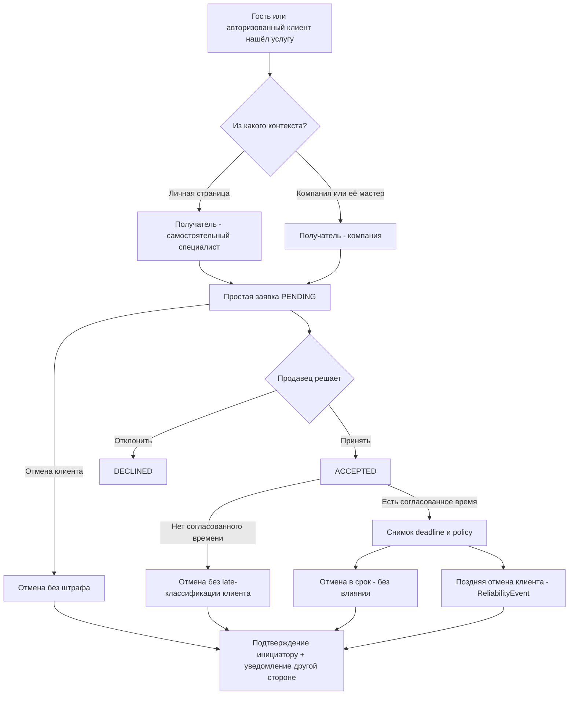

# Services UX v2 — соответствие демонстрационных экранов реальному бизнес-процессу

> **Проектная документация для людей и ИИ-разработчиков.** Это интерактивный `prototype.html`, а не production-приложение. Демо-контакт, заявки, уведомления, отзывы, город и показатель надёжности не отправляются на сервер и не сохраняются между перезагрузками. Статус: DESIGN DEMO, до полного UX sign-off.

## Как открыть и что смотреть

**[Открыть UX-прототип](https://nurgeldiserikbay.github.io/services/prototype.html)**. Для переходов используйте верхнее меню, карточки профилей и кнопки. В кабинете продавца можно принимать заявки, изменять сроки отмены и показываемые поля специалиста. Отдельные разделы имеют hash-ссылки (`#company-professional`, `#request-status`) только для навигации в демо; они не содержат токенов.

| Сценарий | Где в прототипе | Правило и target production |
| --- | --- | --- |
| UX-H01 поиск без регистрации | `#home` | Публичный SSR search с явным city picker и real city IDs; SEO и отсутствие mandatory auth |
| UX-H02 самостоятельный профиль | `#professional` | Публикация одного ProfessionalProfile для Profession, личный seller |
| UX-H03 компания и команда | `#company` | Company/Location/ServiceOffer + отличающийся продавец corporate offer |
| UX-H04 мастер внутри салона | `#company-professional` | Не новая личность. CompanyProfessionalView с одной Affiliation и двумя allowlists |
| UX-H05 личный контакт / заявка | Модальное окно `#requestDialog` | Сервер разрешает offer → seller, гость проходит OTP и получает одну scoped capability |
| UX-H06 ожидающая заявка | `#request-status` | ServiceRequest PENDING, уведомление фактическому продавцу; видит только автор по session/capability |
| UX-H07 принятие/отклонение | `#seller` → «Входящие заявки» | Seller/employee ACL, PENDING → ACCEPTED/DECLINED, message клиенту; нет Quote |
| UX-H08 отмена ожидающей заявки | `#request-status` → «Отменить» | Отмена без customer reliability penalty, **оба NotificationIntent**, idempotency |
| UX-H09 принятая заявка без согласованного времени | `#request-status` | Нет объективного cancellation deadline → нет автоматического штрафа за позднюю отмену |
| UX-H10 отдельная датированная запись | `#client` → «Отменить» | **Только** учебный пример accepted + agreed time и early/late; penalty за late для registered customer |
| UX-H11 документы о качестве и надёжности | `#client` | ReviewRating ≠ ReliabilityScore; мало данных → скрыть публичную оценку |
| UX-H12 разрешённые поля мастера | `#seller` → настройки `#company-professional` | Мастер allowlist ∩ компания selection ∩ platform policy; revoke invalidates published cache |
| UX-H13 разные рабочие контексты | `#seller` → график | Company allocation требует отдельного согласия; private busy-only за пределами своего scope |
| UX-H14 избранное | `#professional`/`#company` → `#client` | Приватные SavedItem владельца аккаунта; продавец не получает список сохранивших |
| UX-H15 уведомления | `#request-status` → журнал | DomainOutboxEvent, NotificationIntent + NotificationDelivery; UI отличает «в очереди» от «доставлено» |

## Два разных контекста одного мастера

`ProfessionalProfile` владеет мастер. `CompanyProfessionalView` — не клонированный профиль, а проекция по организации. Карточка внутри Flora Studio может иметь собственное оформление, должность, корпоративную услугу и разрешённый контент. **Заявка с любого корпоративного CTA направляется организации.** Переход к личной странице — отдельное действие, после него продавцом становится мастер.

**Рендеринг:** для каждого поля `f`: `visible(f) = masterAllowed(f) && companySelected(f) && platformPermits(f) && affiliationActive`. Демо демонстрирует первые две стороны и скрывает портфолио при отзыве разрешения. В production backend также проверяет публикацию, согласие на медиа, связь, права и инвалидацию кеша. Нельзя полагаться на JS-чекбоксы как на защиту приватности.

## Одно обращение, простое движение

**Демо ограничения:** форма пока не осуществляет OTP; личные контакты не передаются, кнопки WhatsApp/звонка выключены. Желаемый день в форме — не согласованное время. Демо-продавец может принять или отклонить только *одну* текущую заявку в памяти; журнал с пометкой «симуляция», никакого отправленного SMS. Реальный продавец не сможет переключаться между ролью клиента и сотрудника без server ACL.

## Рейтинги и уведомления

У продавца по каждому предложению есть правило отмены, и принятое **датированное** соглашение хранит snapshot. После дедлайна зарегистрированному клиенту снижается **отдельная надёжность**, а при отмене продавцом — отдельная надёжность фактического продавца, с исключениями и апелляцией; отзывы о качестве не корректируются отменами. До принятия или без подтверждённой даты автоматический late penalty запрещён. На любую отмену создаются ровно два логических intent в одной DB-транзакции, фактические доставки и retries происходят позже. В демо это текст в журнале, **не** отправленные уведомления.

## Как перейти к реализации

Сопоставление с backend-контрактами:
- [API MVP matrix](../../contracts/api-mvp-matrix.md) и [OpenAPI](../../contracts/openapi.yaml) — seller/context/guest/auth/status.
- [Prisma и SQL](../../contracts/prisma/README.md) — ServiceRequest, CancellationSnapshot, DomainOutboxEvent, notification, company view.
- [ADR-0003](../adr/0003-simple-booking-company-view.md), [ADR-0004](../adr/0004-cancellation-reliability-and-defaults.md), [ADR-0005](../adr/0005-auth-guest-sessions.md) — принятые инварианты.

Каждый экран должен иметь реальный route, loading/error/empty/conflict/offline состояния, права, валидацию, безопасную обработку double-click, abort устаревшего чтения и **не прерывать уже совершённую запись** из-за закрытия экрана. Backend-ошибка 409 должна показать актуальную заявку без повторной отправки с новым idempotency key.

## Проверки и зафиксированные пробелы

`scripts/test-prototype.mjs` проверяет desktop/mobile Chromium и основные переходы. Запускается в `.github/workflows/prototype.yml`; screenshot attachments доступны в Actions. Это browser smoke, **не** backend E2E, юридическая проверка или профессиональный дизайн-аудит.

Не реализованы в демо как настоящая функциональность: полноценные kk/ru тексты, геоданные/реальный поиск, OTP/sign-in, история всех заявок, уведомления, online availability, company branch ACL, no-show review proof, настоящие услуги/цены, админский интерфейс, медиазагрузки. Их не объявлять «готовыми» после успешного screenshot CI. Дальше: завершить Figma-макеты и полный kk/ru, проверить mobile WCAG и создать настоящие vertical slice web/backend после утверждения экранов.
